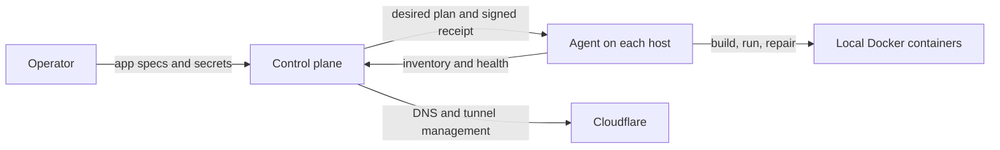

# runner

A self-hosted control plane schedules Docker apps across your own Linux machines and optional GitHub Actions agents. Each app requests a replica count and can constrain placement to regions. Cloudflare Tunnel publishes replicas through your domain. The control plane runs in Docker; SQLite stores app specs, source versions, secrets and operator settings. Runtime state and tunnel credentials stay in memory. Agents retain signed recovery receipts.

Run one agent on each Linux Docker host. A standalone host keeps its slot across restarts. Optional **pools** group replaceable machines with a target count; agents with a `START_CMD` can start replacements when the CP asks. Agents report their region, label and any known deadline (`LIFETIME_MIN`). A host about to shut down can send `POST /api/drain` for an orderly handover. GitHub-specific setup lives in [`machine.yml`](.github/workflows/machine.yml), including its 355-minute lifetime, 330-minute backstop drain and replacement command. See [How it works](#how-it-works) for the entities and their responsibilities.

- **Web app:** `https://runners.<your-domain>`, one page with views for an overview (what needs attention first), apps, machines, metrics, fleet settings and a deploy guide. It works on phones too, with a bottom tab bar. `/admin` and `/metrics` redirect to it, and their old links still land in the right place.
  - **Public views:** apps, source, machines, metrics and deployment status. New self-hosted fleets require the admin password for new deployments and changes to apps without their own password. `REQUIRE_DEPLOY_AUTH=0` enables public deployments explicitly.
  - **An app's env holds its secrets:** `runnerctl env <name> KEY=value` (or `"env": {...}` in a deploy) keeps variables in the control plane and writes them into every copy's `.env`, so compose fills `${KEY}` from it and `env_file: .env` passes them into containers. Values are never shown again, only the names, while the compose file itself is public. Every copy also gets `FLEET_APP`, `FLEET_REPLICA`, `FLEET_MACHINE`, `FLEET_HOST` (its public hostname) and `FLEET_DOMAIN` there: nothing that changes with the replica count or the version, so a replica change restarts no copy that stays. An env change is a new version (same files), so the copies restart with it.
  - **An app with a password asks for it on every change:** whoever deploys an app can give it an app password (optional), or set one later from its page or with `runnerctl password <name>`. From then on, every change made from the site (deploy, replicas, move, enable, disable, delete, a new password) asks, right then, for that password or the admin password. Nothing is kept in the browser: the next change asks again. Fleet changes ask for the admin password the same way.
  - **Needs the admin password (the fleet owner's):** changing the fleet, which covers automatic rebalancing, restarting machines, moving every app off a machine, retiring slots, and showing the join command for a new machine. Those controls show a lock, and using one asks for the password once per browser session (or remembers it on that device if you tick the box).
  - **Metrics:** CPU, memory, disk I/O and network I/O for the fleet, machines and apps. The control plane caches six hours in memory (reset on restart), and each agent keeps six hours locally.

## Set up your own control plane

You need Docker Compose, an active domain on Cloudflare and either a scoped Cloudflare API token or a Global API Key plus the account email. The setup discovers the account/zone IDs, generates fleet credentials and creates the control-plane tunnel.

```sh
cp .env.example .env
chmod 600 .env
# Set DOMAIN and your Cloudflare credential in .env.
docker compose build
docker compose run --rm control init
docker compose run --rm control credentials
docker compose up -d
```

Join each Linux Docker machine using the generated join token:

```sh
curl -fsSL https://runners.example.com/install.sh | sudo JOIN_TOKEN='your-token' sh
```

Installation downloads and verifies the CP's bundled agent release, then builds a local image containing the agent, Node and Docker Compose. Normal agent restarts use that local image or a verified cached release and need no code download. Agents need no Cloudflare management credential. The CP container does not need the Docker socket. See [the complete self-hosting guide](docs/self-hosting.md) for permissions, deployment access, persistence, upgrades and optional GitHub agents.

## Projects

A project is a Docker Compose file, optionally with Dockerfiles and other files its builds need, plus a replica count: how many copies of it run (from 1 to 50, default 1), spread over the machines with the most room; with more replicas than machines, some machines run two or more copies. Each replica has its own URL and there's no shared one in front of them: replicas are numbered from 1, and replica *k* is at `https://<project>-<k>.example.com`, a DNS name the control plane points at the tunnel of whichever machine runs that copy (and moves when the copy moves), so these URLs only change when the replica count does. The port comes from the `port` field, or from `x-runner.port` in the compose file.

- **Compose only:** services use published images.

  ```yaml
  x-runner:
    port: 11470
    replicas: 3
  services:
    server:
      image: stremio/server:latest
      ports: ["11470:11470"]
      restart: unless-stopped
  ```

- **Dockerfile only:** a custom image. The control plane wraps it in a one-service compose file (`build: .`) that publishes the port. The app should listen on that port.
- **WebSockets:** nothing to set: every app's replica URLs take WebSocket connections on the app's port like its HTTP (`wss://<project>-<k>.example.com/...`, any path, through Cloudflare's tunnel and the machine's router). Cloudflare closes a WebSocket that's silent for 100 s, so ping more often than that; a client should reconnect when one closes (a copy moving or handing over ends its connections), and a router reload (another app changing on the machine) keeps open ones for up to an hour.
- **Readiness:** `x-runner.ready: /path` makes the agent ask each copy for that path; a copy counts as healthy (for moves, DNS, handovers) only while it answers 2xx. The agent never restarts a copy for not being ready; one unready for 10 minutes while ready elsewhere is moved like a failing one.
- **Compose plus files:** files sit next to the compose file, so `build: .` or `build: ./web` (with `web/Dockerfile`) find them. You can also include whatever the Dockerfiles `COPY`, as long as it's text. Every machine builds the image when the version changes.

Project names are lowercase letters, digits and dashes, and can't end in `-<number>` or `-m<number>` (those are replica and machine URLs). The control plane checks a spec before accepting it. It must be valid YAML with a `services:` section, every local `build:` needs its Dockerfile, file paths must stay inside the project, and a `port` given alongside the compose file must agree with its `x-runner.port`. The default infrastructure ports are 19080–19082; 2019 is reserved for older routers. Apps deployed without the admin password get an ordinary container only: their compose files can't reach the machine itself (host folders, the Docker socket, privileged mode, host networking and so on are refused with a message naming the setting).

Sending only `{"replicas": N}` (or only a port) for an existing project makes a new version with the latest version's files, so a replica change never puts back files someone else has changed since.

### Placement

Set an agent's `REGION` to a label such as `eu-west`, `ap-south` or `home-lab`, then use the same value as `x-runner.region` in an app's Compose spec. Labels start with a lowercase letter, contain only lowercase letters, digits and dashes, and are at most 32 characters. Explicit labels work anywhere and do not depend on IP geolocation. Without a label, recognized US locations retain the `us-west`, `us-central` and `us-east` defaults. Moves and replacements honor the region; if it has no usable runner, copies wait there. Placement prefers runners with at least 30 minutes before their scheduled departure or hard deadline. The status API and deploy guide show the fleet's current region groups and counts. See [region affinity](docs/region-affinity.md) for the US grouping, handover behavior and an example.

For one of three replicas in each region, use `x-runner.regions: [us-west, us-central, us-east]` instead. Each replica keeps its assigned region across replacements; the list repeats if the count grows.

Each replica goes to the machine with the most room: the least CPU and memory in use (from the machine's latest metrics) and the fewest copies already placed on it, machines that don't run the project yet first. Once every machine has a copy, the next replicas double up on the least busy machines: additional copies use separate fleet-namespaced Compose projects with their published host ports moved out of the first copy's way; each copy answers its own replica's name, so the machine's router tells them apart. A project can't double up if its compose file uses `network_mode: host`, a `container_name` or variables in `ports`; that replica waits and the app's page says why. Two different projects that publish the same host port, or use the same `container_name`, are never placed on one machine either (the second would fail to start). A replica stays on its machine until that machine goes away (its run stops checking in); then it moves to the best machine left, within about a minute, keeping its number and URL. To move one by hand (you're about to remove the machine, say), use **Move** in the project's details or **Move apps off** on the machine: the new copy is placed first, and the old one is removed once the new one is healthy, so nothing goes down. A machine counts as gone only after the control plane has been reachable for a while: after a restart, and after any gap in check-ins longer than the liveness window (its own tunnel dropping, say), nothing is re-placed for 5 minutes, so the first machine back doesn't get every copy.

Placement leaves out servers that are leaving, quarantined, past their due time or with under 30 minutes left, and prefers servers with room (CPU under 70%, memory under 80%). A copy that would double up waits up to 8 minutes for a server that's starting.

Rebalancing is automatic (switch it off on the Fleet page or with `runnerctl rebalance off`). Every automatic move has a cause, and the Activity page lists them:

- **A hot server** (CPU minus steal over 85%, or memory over 90%, in 4 of its last 5 minute summaries) has the app making it hot moved off, if that app uses at least 15% of it, to a server that would still have room with it there. One hot move every 10 minutes fleet-wide, at most 2 off a server an hour, no app twice in 30 minutes; a replica moved for heat waits 30 minutes, then an hour, before it may move again, and stays put after 3 in a day. A server still hot 10 minutes after a move is quarantined for an hour (not a destination).
- **A failing copy**: one that has failed, or not been ready, for 10 minutes on one server while its app is healthy elsewhere moves once, and its app isn't placed on that server again for 6 hours. A version that fails on 2 servers is the app's fault: its copies stay where they are, and an alert says so. In an outage (nothing healthy anywhere) nothing moves.
- **Doubled-up copies**: a server running two copies of an app while a server with room runs none hands one over (not copies younger than 10 minutes).
- **A sick server**: strikes against it (2 apps failing there while healthy elsewhere, half its copies failing, under 10% of its disk free, 5 restarts in an hour) quarantine it for an hour once two come within 30 minutes, and a pool member then asks to leave, so a fresh server takes its slot (one per pool per 30 minutes). 3 sick servers at once is probably an app: nothing is done automatically, and an alert says so.

Moves in flight stay under min(8, 10% of the servers), one arriving per server at a time, and an app changes only as much as its budget allows (20% of its replicas at once, at least one). Every app is treated alike: a move starts the new copy first and drops the old one only once the new one works. A breaker pauses all automatic moves for an hour, with an alert, when they look like thrashing: more than 3 between two servers in 2 hours, more than 6 in an hour, or a replica moved a second time within 2 hours. A move never trades a working copy for one that doesn't work: if the new copy fails or takes too long, the move is called off and the old copy stays. Lowering the count removes the highest-numbered replicas; raising it adds the next numbers. Each app's page shows where each replica landed and why.

### Departures

Servers can be short-lived, so the control plane decides when each one leaves. A run that reports its deadline is due somewhere between 4 h and 5 h 10 min after its start (a fixed spread per run), and never later than 45 minutes before its deadline. A due run hands over to a successor on its own slot: the successor builds the same copies and opens its tunnel once it serves everything the old run does, then the old run exits, so nothing moves and no DNS name changes. Departures go one per pool and 3 fleet-wide at a time, earliest deadline first, at most 4 in 10 minutes; a run whose apps are already changing as much as they may waits, and the Activity page says why. Under 25 minutes from its deadline, a run goes regardless. When new servers aren't arriving (a requested start doesn't join within minutes), departures that would wait for one move their copies out first instead. A server that goes silent keeps its copies for its slot for a while, so the replacement its pool starts inherits them; 3 or more going silent together is treated as the control plane losing its network, not as deaths. Drains and rolls wait their turn the same way.

**Live logs.** An app's page shows a replica's logs as they're written: watching them takes the app's password, or the admin password (an app without one: the admin password), and the app's env values are hidden. Nothing is collected or kept: the page opens a WebSocket to the control plane, which wakes the copy's server; its agent runs `docker compose logs --follow` for that copy and streams it over its own WebSocket, and the control plane passes the lines through. Closing the viewer or leaving the page stops it all.

**Failure details.** Public status and activity report that a workload failed without exposing command output. `POST /api/projects/<name>/diagnostics` returns its current error details and requires the app password or admin password, even when the fleet allows public deployments. Diagnostics remain in CP memory and secret values are redacted.

The Activity page shows the churn (copies started by cause, moves, DNS re-points), the departures coming up and how the last day's went (cold when a replica had no healthy copy because of one, with handover times), replicas with no healthy copy right now, and alerts. Set `ALERT_WEBHOOK` to have alerts posted as JSON (`text` and `content`, for Slack- and Discord-style hooks).

### Rollouts

Each change is a new version, and every machine switches to it at once. Nothing is rolled back automatically (dropped on purpose): a failing version stays failing, and the app's page shows each failing machine's error until you deploy a fix or roll back from the Versions list. A disabled project keeps its spec and versions but runs nowhere.

## API

The web app uses `/admin/api/*`; scripts use `/api/*`; they're the same API. Status, source and metrics are public; logs, diagnostics and administrative credentials require authentication. New self-hosted fleets require the admin password to deploy or change unlocked apps (`REQUIRE_DEPLOY_AUTH=1`); public deployments are an explicit opt-in with `REQUIRE_DEPLOY_AUTH=0`. With that opt-in, `PUT /projects/<name>` creates or updates an app with no credentials. A `"password"` (6+ characters) in a new app's body locks it; from then on changing it (`PUT`, `/enable`, `/disable`, `/move`, `DELETE`, and `PUT /projects/<name>/password` with `{"password": "new"}`, which also locks an open app) needs the header `x-app-password` or `x-admin-password`. `PUT /projects/<name>/env` with `{"KEY": "value", "OLD": null}` sets and removes the app's env variables (same credentials as any change; `GET` gives the names only; a deploy body may carry `"env"` too). Fleet routes (`/settings`, `/roll`, `/machines/<n>/evict`, `/slots/<n>`, `/join-token`) need `x-admin-password`. App passwords are stored as salted PBKDF2 hashes and never sent out; the status only says `hasPassword`. An address that sends a wrong password 5 times is refused for 15 minutes, counted separately for the fleet and for each app. Deploys without the admin password get an ordinary container only (see Projects). Machines use `/api/*` with the join token (`Authorization: Bearer <join token>`).

```
GET    /api/status                              projects and machines (no token needed)
GET    /api/metrics?range=1h|6h|24h|7d|30d      metrics columns per machine and app, plus live samples (no token needed)
PUT    /api/projects/<name>                     create or update: {"compose": "...", "dockerfile": "...", "files": {"path": "text"},
                                                "port": 8080, "replicas": 3}  (compose or dockerfile required)
GET    /api/projects/<name>[?version=N]         a version's compose file, files and port, plus the version list
POST   /api/projects/<name>/disable | /enable   stop / start it on every machine
DELETE /api/projects/<name>                     delete it and its versions
POST   /api/roll[?machine=N]                    replace machines one at a time
DELETE /api/roll                                call a roll off: servers go back to their own schedules
PUT    /api/settings                            {"pools": {"<pool>": 10}, "rebalance": true}  (machines to keep per pool; automatic rebalancing)
POST   /api/projects/<name>/move?from=N[&to=M][&replica=K]  move one copy off machine N (to M, or the machine with the most room)
POST   /api/machines/<n>/evict[?force=1]        move every placed project off machine n (apps changing as much as they may wait, unless forced)
POST   /api/projects/<name>/logs?replica=K      watch a replica's live logs: a session, for the WebSocket /admin/api/logs/<session> (the app's password or the admin password)
POST   /api/projects/<name>/diagnostics        current failure details (the app's password or the admin password)
GET    /api/events?since=&kinds=&app=&machine=&limit=  recent changes; hybrid history is disposable and partly recovered from agents
DELETE /api/slots/<n>                           retire an empty slot: tunnel, records and DNS names go
GET    /api/join-token                          the join token (needs the admin password)
POST   /api/join                                an agent starting up: {"agent", "pool", "url", "label", "want"} -> its slot and tunnel token
POST   /api/claim?pool=<name>                    machines to start so the pool has its size (for a watchdog outside the pool)
POST   /api/drain                               {"agent": id}, {"run": id} or {"machine": n}: it's going down soon, hand it over
WS     /api/agent                              (agents) authenticated reports, plans and requests for a fresh report; replaces /api/wake
WS     /api/logs/stream?session=<id>&run=<run>  (agents) a live log stream for a session
```

```sh
curl -X PUT https://runners.example.com/api/projects/hello -H 'Content-Type: application/json' -H "x-admin-password: $ADMIN_PASSWORD" \
  -d '{"dockerfile": "FROM python:3.12-alpine\nCMD [\"python\", \"-m\", \"http.server\", \"9000\"]", "port": 9000}'
```

[`bin/runnerctl`](bin/runnerctl) wraps the API and requires Bash, curl 7.76 or newer, jq and Python 3. Set `RUNNER_URL` or `~/.config/runnerctl/url` to your CP URL. It sends the admin password from `$ADMIN_PASSWORD` or `~/.config/runnerctl/admin-password`; new self-hosted fleets require it for deployments and fleet changes. Failed API requests return a nonzero exit status and the server's error message.

```
runnerctl apply examples/hello --port 9000 --replicas 3   # a folder: Dockerfile + what it COPYs (+ compose file, if any)
runnerctl apply examples/stremio.yml         # a compose file
runnerctl apply path/to/Dockerfile myapp --port 8000
runnerctl status | get <name> [version] | disable <name> | enable <name> | rm <name>   # status marks a doubled-up copy with *
runnerctl roll [n] | pool <name> <n>
```

## Your own machines

Any Linux machine with Docker can join. Get the command, token included, from the Fleet page ("Add a machine"), or the token with `runnerctl join-token`, then on the machine:

```sh
curl -fsSL https://runners.example.com/install.sh | sudo JOIN_TOKEN=<token> sh
```

Add `LABEL=<name>` to name it on the status pages and `REGION=eu-west` (or another region slug) to label its placement region. A machine joined this way stands on its own (no pool) and keeps its slot across restarts; the web app doesn't show pools at all, it's just one set of machines.

The installer prints the agent container name after building its local image. The agent takes the lowest free slot and keeps it across restarts. A normal restart uses local code; an explicit roll verifies and stages a new release before restarting, retaining the running release if the download fails. Re-run the installer to update Node and Docker Compose in the image. A host without `POOL` is standalone and doesn't count toward any pool's size.

Containers managed by the agent have a fleet-specific `io.runners.owner` label; app containers also have `io.runners.copy`, while the router and connector have `io.runners.component=router` or `tunnel`. The agent checks ownership before stopping or adopting containers, so unrelated Docker workloads can coexist on the host. To remove a host, move its apps off through the dashboard, stop its agent, and remove only that fleet's owned infrastructure containers. Then retire its slot from the web app or with `runnerctl retire <n>` so its tunnel and DNS records are removed.

## How it works

The **control plane decides what should run and where**. Each **agent makes that plan happen on its own host**. Only the CP chooses placements, manages Cloudflare DNS/tunnels and accepts desired configuration changes. Agents build, run, check and repair containers; they can keep an approved workload running while the CP is unavailable.



### Entities

| Term | Meaning |
| --- | --- |
| App / project | One desired definition: Compose, source files, secrets, replica count and region constraints. |
| Replica | A numbered instance of an app, such as `gdrive-2`. Its number and public URL survive moves. |
| Copy | A replica's placement on a machine. During a move, old and new copies can overlap until the new one is healthy. |
| Machine / slot | The CP's numbered fleet position, with a stable tunnel identity. A replacement host can take the same slot. |
| Agent | The host's Docker manager. Its private local state keeps its identity across restarts. |
| Run | One incarnation of an agent. A process crash resumes it; a reboot or deliberate upgrade creates a new run. Old and new runs can overlap on a slot during handover. |
| Pool / region | Optional labels: a pool manages a target number of replaceable machines; a region constrains app placement. |

An app can contain several Compose services. For example, one GDrive replica includes both its app container and WARP container; those services move together.

### Reports, plans and recovery

The agent opens one outgoing WebSocket to the CP. It reports inventory, health and metrics, and receives a desired plan. Reports normally run every 20–300 seconds according to fleet size (`POLL_S` overrides this); the CP can request a fresh report immediately. The agent checks health every 10 seconds and repairs approved workloads locally. Viewing logs opens a separate temporary stream; the CP does not store the log contents.

On a CP restart, agents keep serving while it loads desired configuration, rediscovers tunnels from Cloudflare and collects agent reports and signed receipts. Up to three healthy agents also retain a signed fleet snapshot to recover interrupted moves or missing peers. These agents are recovery witnesses; they do not make scheduling decisions. The CP then reconciles the recovered inventory with its current specs: deleted apps are removed, existing apps converge to the current version and missing replicas are placed. A late receipt cannot overwrite a placement already decided by the running CP.

### What survives a restart

| Location | State |
| --- | --- |
| CP SQLite on disk | App specs/source versions, app secrets/password hashes, desired fleet settings and app rollout decisions. |
| CP private configuration | Management credentials, join token, signing key and stable fleet namespace. |
| CP RAM, including SQLite TEMP tables | Health, placements, runs, metrics, events, diagnostics and discovered tunnel IDs/tokens. |
| Agent's disk | Identity, approved plan, receipt, local connector token, recent metrics, verified agent code and app data. App data is not replicated between hosts. |

Normal reports, health checks and placements make **no persistent CP writes**. Configuration changes and committed app rollout decisions can write SQLite. [`state-policy.js`](control/src/state-policy.js) defines the durable tables/settings and is shared by storage and receipt recovery; a receipt cannot replace those authoritative settings.

### Reading the code

Start with [`control/server.mjs`](control/server.mjs) for HTTP/WebSockets, then [`Control.sync()` in index.js](control/src/index.js) for report → reconcile → plan. [`local-store.mjs`](control/src/local-store.mjs) enforces the persistence boundary. On the host, [`agent.mjs`](agent/agent.mjs) contains `main()` and `reconcile()`; [`runtime.mjs`](agent/runtime.mjs) handles ownership, safe files and recovery helpers. [`control-link.mjs`](agent/control-link.mjs) carries reports and plans. The archived Mac/Worker implementations are outside this path.

### Self-healing

- A departing machine hands over to a replacement on its own slot, without downtime: with a `START_CMD` it starts one for its own slot; without, it restarts its agent.
- If a pool member dies, members that can start machines start a replacement within about 2 minutes; for a pool whose members can't, whatever watches it starts the slots `POST /api/claim?pool=<name>` returns.
- On GitHub Actions, the control plane schedules each machine's departure from its reported deadline (a backstop drain at 330 minutes covers a control plane that didn't), and the workflow stops the agent before the 6-hour limit. A run that ends on its own then asks the control plane what's missing and starts it. If the control plane cannot be reached, the watchdog retries when it returns; a sufficiently long CP outage can therefore exhaust short-lived runners. A cancelled run doesn't request replacements: cancelling the runs is how a pool is stopped by hand.
- [`watchdog.yml`](.github/workflows/watchdog.yml) is scheduled every 10 minutes and starts machines if none are left. GitHub runs scheduled workflows late or skips them when it's busy (hours apart has been seen), so it's the backstop, not the mechanism.
- [`roll.yml`](.github/workflows/roll.yml) restarts the fleet one machine at a time when the agent changes.

## Running the control plane

Use the [self-hosting guide](docs/self-hosting.md) for Docker setup and recovery. [VPS deployment notes](docs/vps-control.md) document the existing Billy Bishop fleet. The Mac and Cloudflare scheduler implementations are inactive historical alternatives; there is no Worker, Durable Object or D1 dependency for scheduling.

The production server also runs locally for development:

`control/server.mjs` needs Node 24 (for `node:sqlite`) and `npm install` in `control/` (the `yaml` and `ws` packages). Settings and secrets come from the environment: `PORT` (8920), `DATA_DIR` (where `control.db` lives), `DOMAIN`, `CONTROL_HOST`, `ZONE`, `ACCOUNT_ID`, `POOLS` (default pool sizes, JSON), `MAX_SLOTS`, `ADMIN_PASSWORD`, `JOIN_TOKEN`, `STATE_SIGNING_KEY` (a persistent random secret for agent recovery receipts), and `CF_API_TOKEN` (a token with DNS edit on the zone and Cloudflare Tunnel edit on the account; or `CF_API_KEY` plus `CF_API_EMAIL`). Use `INIT_CONTROL_DB=1` only when starting a new fleet, then remove it; a missing or incomplete database otherwise prevents startup. Recovery holds workloads for `RECOVERY_MS` (default three minutes) while agents reconnect. `MEMORY_HISTORY_MIN` bounds cached metrics (default 360). `AGENT_URL` can override the bundled agent download URL (default: the controller's own `/agent/` endpoint). `DNS=off` stops it touching DNS (for a copy you're trying things on). `ALERT_WEBHOOK` gets alerts. For tests, `QUIET_MS` (the quiet period after a restart, default 10 minutes) and `YOUNG_MS` (how old a copy must be before it's moved automatically, default 10 minutes) shorten the waits. `BIND_HOST` defaults to 127.0.0.1 for direct Node execution and 0.0.0.0 in Docker; a Cloudflare tunnel (`cloudflared tunnel run`, ingress `runners.<domain>` → `http://127.0.0.1:8920`) gives it its name.

The Docker setup uses a persistent data volume and private `.env` configuration. [Self-hosting instructions](docs/self-hosting.md) cover initialization, networking, backups and migration. [Billy Bishop deployment notes](docs/vps-control.md) describe the existing fleet. Startup also waits for a complete Cloudflare tunnel listing before scheduling or changing DNS. Failed listings retry every minute; existing agents keep their workloads while the controller recovers. Tokens are fetched only when machines join and retained in RAM until restart. `GET /api/export` and `POST /api/import` (admin password) move server state; stop scheduling before importing a final snapshot.

## Tests

`control/test/*.sh` run the control plane locally (`test/start.sh`, on port 8911) against a fake Cloudflare API and drive it the way the agents and the web app do; see [`control/test/README.md`](control/test/README.md). `control/test/sim/*.test.mjs` run it in-process on a fake clock with a simulated fleet (servers that build, fail, get hot, run out of disk, hand over and stop at their deadline), hours of fleet life in seconds: `node control/test/sim/phase3.test.mjs`. Agent runtime, ownership, recovery and offline code-launching checks live in `control/test/agent-runtime.mjs` and `control/test/agent-launcher.mjs`. Docker smoke tests exercise initialization, crash recovery, competing schedulers and the bundled tunnel supervisor against a local fake Cloudflare API.

## Setup notes

- **Repo settings:** variable `CONTROL_URL` (your public controller URL) and secret `JOIN_TOKEN` (the same value as the control plane's `JOIN_TOKEN`). Optional variable `REGION` gives that repository's agents an explicit placement region. Tunnel tokens come from the control plane.
- **Control plane secrets:** two you use, `ADMIN_PASSWORD` (the fleet owner's master password: locked apps and fleet changes need it; the web app asks for it, and `runnerctl` sends it; `FLEET_PASSWORD` and the header `x-fleet-password`, its old names, still work) and `JOIN_TOKEN` (machines join with it: `install.sh` takes it, and the GitHub repos have it as the secret `JOIN_TOKEN`), plus `CF_API_TOKEN`, which only the control plane uses: a Cloudflare token with Tunnel edit on the account and DNS edit on the zone. App passwords are kept by the control plane.
- **Web app:** changes sent from other sites are refused.
- **History:** until 2026-10-03 the control plane was a Cloudflare Worker with a Durable Object, and the replica URLs went through the Worker. The Workers free plan's 100,000 requests a day (the machines' check-ins alone were 86,400) is why it moved.
- **More machines:** raise a pool's size with `runnerctl pool github <n>` (the web app doesn't show pools) (tunnels are made as needed; there's no cap unless `MAX_SLOTS` is set). Change sizes there rather than through the repos' `POOL_SIZE` variable: machines keep re-sending the size they started with, so a change there only takes hold as they're replaced. GitHub Free runs 20 jobs at once, and handovers overlap briefly, so stay at about 18 or fewer. Cloudflare allows 1,000 tunnels per account. Default sizes come from the controller’s `POOLS` environment setting, with persisted settings taking precedence.
- **Another GitHub account:** a copy of this repo there (public, so Actions minutes are free) is a pool of its own in the same fleet. Give it the `JOIN_TOKEN` secret and the repo variables `CONTROL_URL` (your controller URL), `POOL` (the pool's name), `POOL_SIZE` (how many machines it keeps) and `AGENT_REPO=your-org/runner`, so its machines run this repo's agent and agent changes need no copying. Disable its `roll` workflow: a roll from here already restarts every pool. Workflow changes do need copying there (merge this repo's main into its main; it isn't a fast-forward).
- **The machines are pinned to `ubuntu-24.04`**, not `ubuntu-latest`, so a new Ubuntu release doesn't change the machines under the fleet; move the pin on purpose. The run logs show only the router's and tunnel's logs, never the apps' (the repos are public).
- **The join token only joins.** A machine started for a slot that's live gets that slot only if the control plane asked for a machine there (a handover's replacement, or a claimed start); otherwise it's given a free slot instead, so the token alone can't take over a live machine's tunnel.
- **Watchdog pausing:** GitHub pauses scheduled workflows in public repos after 60 days without repo activity.
