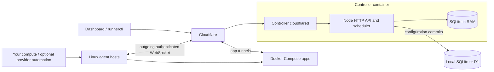

# Architecture

Runners is a web app and API backed by one active controller and a fleet of Linux agents. The controller can run alone or as the elected primary of a [replicated cluster](control-replication.md).
The controller can run in Docker on a Linux server or on a Mac through Colima.
Application containers run on the agent hosts.

## Dashboard and controller

`control/src/app.html` is served by `control/server.mjs`. The same process exposes
the HTTP API, authenticated agent WebSockets, metrics and live-log forwarding.
`control/src/index.js` validates desired app configuration and reconciles it with
reports from the agents. It places replicas, manages moves and handovers, and
requests Cloudflare DNS/tunnel resources. Public app traffic travels directly
through Cloudflare to the app hosts; it does not pass through the controller.

The Docker image bundles Node 24, controller dependencies, cloudflared and the
matching downloadable agent release. Its entrypoint supervises the server and
connector together. If either exits, the container exits so Docker can restart
it. It runs as UID 1000, without the Docker socket or elevated capabilities.
A lock prevents concurrent controllers using the same Linux data volume.

On a Mac, `control/mac-docker.py` runs under launchd and starts the dedicated
Colima engine and Compose service. Docker owns the Node/connector processes.
The wrapper holds an AC-power idle-sleep assertion and supervises the controller.
The [Mac runbook](mac-control.md) covers service operation and availability.

## State and recovery

`control/src/d1-store.mjs` persists five configuration tables in Cloudflare D1 when
`CONFIG_STORAGE=d1`. `local-store.mjs` also supports
local SQLite for standalone installations. The tables are:
`projects`, `versions`, `settings`, `app_passwords` and `app_env`. They contain the
authoritative app definitions, source history, operator settings and secrets.
`identity.json` and the private controller environment preserve fleet identity
and Cloudflare access. Preserve these files together when moving the controller.
D1 mode loads a private in-memory working database at startup and commits changed
configuration rows atomically before acknowledging edits. No local `control.db`
is used. A stale revision or unconfirmed write stops new plans and restarts the
process; existing agents keep their approved workloads. See [D1 storage](d1-storage.md).

Machine reports, scheduling observations, metrics and tunnel credentials remain
in controller memory. Agents retain their approved plans, inventory and signed
recovery receipts locally. After a restart the controller discovers tunnels and
waits for agent reports before scheduling. Receipts recover observations; they
cannot reconstruct missing app source, password hashes or application secrets.
The default recovery hold is three minutes.

In single-controller mode, run exactly one controller for a fleet. Replicated mode uses memory-only Raft quorum checks and agent authority checks; D1 holds application configuration only. See [control replication](control-replication.md). A local volume lock cannot fence another
computer or another volume. Before migration, disable the old scheduler and its
automatic startup, preserve the public origin, join token, signing key and tunnel
namespace, and use the same D1 database (or transfer the stopped SQLite files for local storage). Never initialize a new empty
fleet as an outage-recovery shortcut.

## Agents and providers

`agent/agent.mjs` applies controller-approved plans to Docker Compose on a Linux
host. Its helpers manage container ownership, router/tunnel connections, metrics,
stable local data paths and verified agent releases. Host failure, application
readiness and replacement capacity are distinct signals. Agents can continue
serving approved workloads while the controller is unavailable.

The controller accepts supplied capacity and the agent reports an origin tag.
Neither contains GitHub account lists, app-specific behavior or desired machine counts. Logical controller membership, machine tags, regions and source URLs are deployment configuration; there is no required Mac/fleet split. Provider
adapters own those targets and create machines. GitHub's independent account
schedules are documented in [provider adapters](providers.md).

App data stays on the machine unless the app implements replication or shared
storage. Scheduling another replica does not copy an application's volumes.

## Access and release boundaries

The dashboard, status, metrics and app source are public. App environment values,
logs, diagnostics and administrative actions require their relevant credentials.
New fleets require deployment authentication; existing fleets retain their
configured policy. Only the controller holds Cloudflare management credentials.
Agents receive fleet credentials and scoped tunnel connection tokens.

Build images from the repository root so `control/` and `agent/` stay together.
Updating a controller image does not automatically restart all application
containers. Agent upgrades are an explicit roll or provider job replacement;
ordinary agent restarts use verified local code. See [controller](../control/README.md),
[agent](../agent/README.md) and [tests](../control/test/README.md).

## Connection and workload recovery boundaries

Each agent WebSocket is bound to one validated run. Reports are processed in
order, with at most eight queued requests per connection; a client that exceeds
that limit reconnects. Invalid reports never count as connected agents, and a
new valid connection replaces that run's previous socket. Slow receivers are
disconnected before outgoing buffers grow without bound.

Agents ignore unknown protocol extensions without losing their pending plan.
Malformed replies close the connection and reject pending requests so the agent
can reconnect while approved workloads keep running. A deployment waiting for a
previous app to release its ports is checked against the latest accepted plan
before it starts; cancelled work stays cancelled. Failed removals hold new work
for another reconciliation attempt. Temporary state files are cleaned up after
failed writes, while the previous complete inventory is retained.

Ordinary app source updates still replace all copies together. Moving a replica
waits for the replacement's readiness, but a source update is not a rolling
release. Application data remains local to each host. For a replicated control
plane, retain a quorum of live memory or use the explicit recovery procedure in
[control replication](control-replication.md); an unavailable minority cannot
bootstrap itself. Start with `CP_REPLICAS=1` when you do not need coordination.
